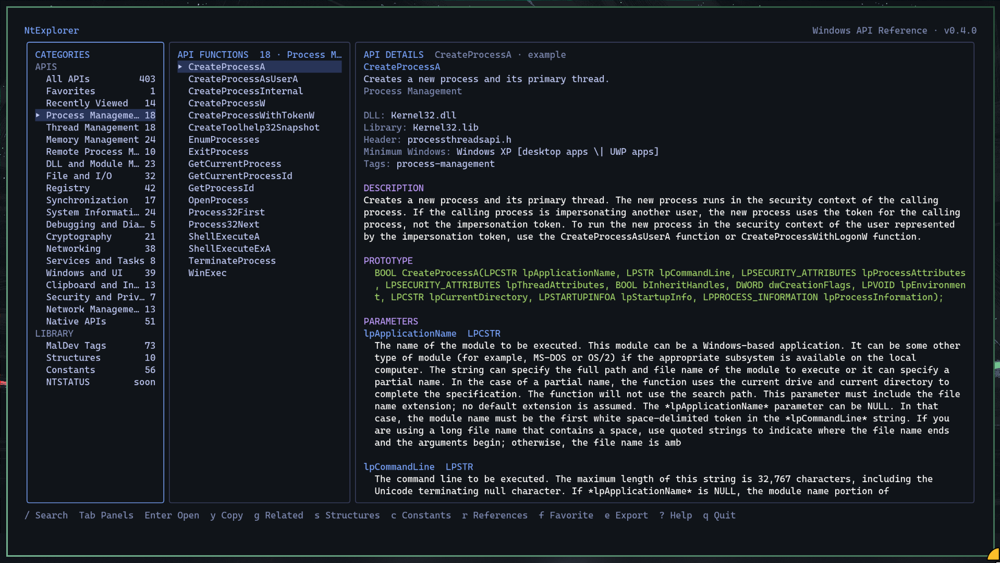

# NtExplorer

NtExplorer is an offline-first, keyboard-driven terminal reference for Windows APIs, aimed at people learning Windows internals, malware analysis, and defensive investigation.

It ships a bundled, versioned JSON catalog inside a single executable. Browsing and searching work with no network connection and no administrator privileges. NtExplorer **documents** APIs — it never calls catalogued functions, executes examples, or manipulates other processes.



## Features (Release 0.5)

- **453 documented APIs**, including all 370 APIs in the bundled MalAPI.io reference, with 101 Native/RTL routines in their own category.
- **A displayed example for every API**, each one calling the documented routine. Privileged or destructive operations act only on resources the example creates itself and cleans up afterward.
- **18 categories** spanning process, thread, memory, remote-memory, module, file, registry, synchronization, system/debugging, cryptography, networking, network management, services, Windows/UI, clipboard/input, security/privileges, and Native APIs.
- **10 documented Windows structures** with C definitions, member-by-member descriptions, notes, and source references.
- **56 documented constants and flags** with exact values, categories, descriptions, tags, and source references.
- **1,799 NTSTATUS values** covering the Microsoft MS-ERREF table, with 32-bit values, severity, concise descriptions, name/value/severity search, and Microsoft references.
- Search by exact name, prefix, substring, alias, category, tag, description, and parameter text. Results show **why** each entry matched.
- Structure search covers names, members, tags, summaries, notes, and definitions.
- Constant search covers names, numeric values (`0x1000`, `4096`, and `0x00001000` are equivalent), categories, tags, descriptions, and references.
- NTSTATUS search covers names, values in hexadecimal or decimal (`0xC0000022` or `3221225506`), severity, descriptions, and references.
- Detail pages with prototype, ordered parameters, return contract, DLL/header, remarks, Unicode notes, MalDev context, defensive context, code example, related APIs, and related structures.
- Constant detail pages show the value, category, tags, description, related APIs, and references.
- Cross-links in both directions: an API lists its structures and constants; a structure or constant lists the APIs that reference it.
- Related-API navigation, reverse structure and constant links, and a references view.
- Favorites and recently viewed entries, stored locally.
- JSON and Markdown export for APIs, structures, constants, and NTSTATUS values, with explicit overwrite confirmation.
- Panel- and section-aware copy (`y`) through the terminal clipboard, so copied text never includes adjacent panels or borders.
- Responsive 3-panel layout that adapts down to narrow and stacked terminals.
- Runtime catalog validation plus a `validate-data` command for CI.
- Fully offline. No telemetry and no network requests.

Native APIs appear in the **Native APIs** category. NTSTATUS values and names mirror the Microsoft MS-ERREF reference; severity is derived from NTSTATUS bits 30 and 31 and checked during validation. They are presented as reference data only.

## Install and run

Requirements: Go 1.25+ to build from source.

```bash
# Run from source
go run ./cmd/ntexplorer

# Build for the current platform
go build -trimpath -o dist/ntexplorer ./cmd/ntexplorer

# Build Windows x64
GOOS=windows GOARCH=amd64 go build -trimpath -o dist/ntexplorer.exe ./cmd/ntexplorer
```

PowerShell:

```powershell
$env:GOOS = "windows"
$env:GOARCH = "amd64"
go build -trimpath -o dist/ntexplorer.exe ./cmd/ntexplorer
Remove-Item Env:GOOS -ErrorAction SilentlyContinue
Remove-Item Env:GOARCH -ErrorAction SilentlyContinue
```

The executable is self-contained and works without Go installed. No administrator rights are required.

### Command line

```text
ntexplorer                 Browse the bundled catalog
ntexplorer --data DIR      Use an external catalog directory
ntexplorer validate-data   Validate catalog data and exit
ntexplorer version         Print the version
ntexplorer help            Show usage
```

## Keyboard reference

| Key                    | Action                                                         |
| ---------------------- | -------------------------------------------------------------- |
| `↑` / `↓` or `j` / `k` | Move selection / scroll detail                                 |
| `PgUp` / `PgDn`        | Page through a panel                                           |
| `Home` / `End`         | First / last item                                              |
| `Ctrl+U` / `Ctrl+D`    | Half-page detail scroll                                        |
| `/`                    | Search                                                         |
| `Esc`                  | Clear search or go back                                        |
| `Tab` / `Shift+Tab`    | Move between panels                                            |
| `Enter`                | Open selected API/structure/constant/NTSTATUS value or apply tag |
| `g`                    | Related APIs, or reverse API links for a structure or constant |
| `r`                    | References                                                     |
| `f`                    | Toggle favorite (API entries)                                  |
| `e`                    | Export entry as JSON or Markdown                               |
| `y`                    | Copy the focused panel selection, or choose a detail section   |
| `x`                    | Show/hide examples                                             |
| `s`                    | Open Structures; from an API, its first related structure      |
| `c`                    | Open Constants; from an API, its first related constant        |
| `?`                    | Help                                                           |
| `q`                    | Quit                                                           |

Bindings are centralized in `internal/tui/keys.go`.

## Copying text

Terminal-native selection is line-based. In the three-panel layout a dragged line also contains text from the neighboring panels, so copying a detail section that way brings the sidebar and list along.

Press `y` instead. NtExplorer copies only the focused panel and never includes borders or neighboring columns:

- **Detail panel:** choose the entire entry as Markdown, or one section such as Description, Prototype, Parameters, Return value, Example, Related entries, or References. NTSTATUS entries offer value, severity, description, and references.
- **List panel:** copy the highlighted API, structure, constant, NTSTATUS value, or tag.
- **Categories panel:** copy the highlighted sidebar item.

The copy menu shows a preview and character count before writing. NtExplorer uses the terminal clipboard sequence (OSC 52), which works in most modern terminals, including over SSH, without helper programs or network access. If nothing is pasted, enable clipboard writes in your terminal; in tmux, `set -g set-clipboard on` is usually required. Very large selections are rejected rather than truncated.

## Search behaviour

Queries are case-insensitive and split into terms; every term must match. Ranking follows this order:

1. exact API name
2. API name prefix
3. API name substring
4. alias
5. category or tag (full-phrase category matches are boosted)
6. summary / description
7. parameter text, module, notes, prototype

Each result row shows its match reasons, for example `VirtualAllocEx · name prefix`.

Search is scoped to the active view: `/` in the Structures view searches structure names, members, tags, summaries, notes, and definitions; `/` in the Constants view searches constant names, numeric values, categories, tags, descriptions, and references; `/` in the NTSTATUS view searches status names, numeric values, severity, descriptions, and references; elsewhere it searches the API catalog. Structure ranking prioritizes exact and prefix names, then member names, types, tags, and descriptive text. Constant and NTSTATUS ranking prioritize exact names and numeric values, then categories or severity, tags, and descriptive text. Numeric terms are compared by value, so `0x1000`, `4096`, and `0x00001000` all match `MEM_COMMIT`.

## Data and configuration

Catalog data lives in `data/` and is embedded into the binary with Go's `embed` package:

```text
data/
├── catalog.json            categories, tag vocabulary, catalog version
├── apis/                   API records grouped by topic
│   ├── process.json
│   ├── threads.json
│   ├── memory.json
│   ├── modules.json
│   ├── files.json
│   ├── registry.json
│   ├── synchronization.json
│   ├── system.json
│   └── cryptography.json
├── constants/constants.json     constant values, tags, and references
├── structures/structures.json   structure definitions, members, and notes
└── ntstatus/statuses.json       NTSTATUS values, severity, and Microsoft references
```

Optional user configuration is read from the standard application config directory (`%AppData%\NtExplorer` on Windows, `$XDG_CONFIG_HOME/NtExplorer` on Linux):

```json
{
  "theme": "dark",
  "initial_category": "Memory Management",
  "show_examples": true,
  "catalog_dir": "",
  "max_results": 25
}
```

Favorites, recent entries, and the last category are stored in `state.json` in the same directory. Set `NTEXPLORER_CONFIG_DIR` to override the location (useful for portable installs and tests). Invalid configuration is non-fatal: defaults are used and a warning is shown.

External catalogs can be used with `--data DIR` or `catalog_dir`. They must contain `catalog.json` and `apis/*.json`.

## Validation and tests

```bash
go test ./...
go run ./scripts/validate-data.go
# or
go run ./cmd/ntexplorer validate-data
```

Validation checks schema versions, unique non-empty IDs, duplicate names, category membership, prototype/return presence, unique parameter names, resolvable related IDs, references, tag conventions, NTSTATUS value/severity consistency, and record-level issues with file/record context. Invalid catalog data produces a readable startup error rather than a panic.

## Safety and scope

NtExplorer is a reference and learning tool. It does not:

- invoke APIs selected from the catalog;
- execute code samples;
- inject into or manipulate other processes;
- generate or run payloads;
- implement persistence, credential access, or evasion.

Examples are displayed as plain text, use the current process where possible, and are marked illustrative. Any future interactive Windows inspection must be a separately scoped feature with its own review.

## Roadmap

- **0.1** — Win32 + MalDev reference TUI.
- **0.2** — Structures browser and API/structure cross-links.
- **0.3** — Constants browser and API/constant cross-links.
- **0.4** — Full 370-API catalog, Native/RTL category, and an example for every API.
- **0.5** — NTSTATUS browser, verified status values, search, details, exports, and copy support (this release).
- **0.6** — Optional read-only PE export inspection using Go's `debug/pe`.

## Repository layout

```text
cmd/ntexplorer/       CLI entry point
internal/app/         application layer: search, favorites, state
internal/catalog/     models, loader, validator
internal/search/      ranking and filtering
internal/tui/         Bubble Tea model, update, views, styles, keys
internal/config/      optional config and state
internal/export/      JSON and Markdown export
data/                 embedded offline catalog
scripts/              validate-data command for CI
docs/                 architecture, data format, contributing
```

## Sources and attribution

Catalog entries link to Microsoft Learn documentation and are written in original wording. API names, prototypes, constants, and structures remain the property of their respective owners. NtExplorer is not affiliated with or endorsed by Microsoft or System Informer.

Third-party Go dependencies: [Bubble Tea](https://github.com/charmbracelet/bubbletea), [Bubbles](https://github.com/charmbracelet/bubbles), [Lip Gloss](https://github.com/charmbracelet/lipgloss), and their transitive dependencies. See `go.mod` for the pinned versions and each project for its license.

## License

MIT — see [LICENSE](LICENSE).
